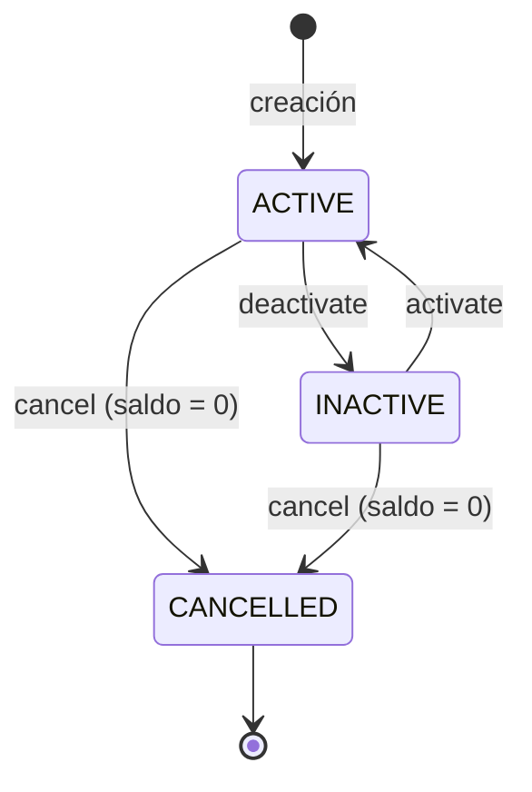

# 1. Requerimientos

## 1.1 Contexto

Aplicación usada por los trabajadores de una entidad financiera para:
- Administrar clientes (registrar, actualizar y eliminar).
- Crear productos financieros (cuentas) a los clientes.
- Hacer movimientos transaccionales sobre esos productos y consultar estados de cuenta.

## 1.2 Requerimientos funcionales

### Clientes

| ID | Requerimiento | Regla de negocio |
|---|---|---|
| RF-01 | Crear cliente | Atributos mínimos: id, tipo de identificación, número de identificación, nombres, apellido, correo electrónico, fecha de nacimiento, fecha de creación y fecha de modificación. |
| RF-02 | Consultar clientes | Listar clientes y consultar un cliente por id. |
| RF-03 | Actualizar cliente | La **fecha de modificación** se calcula automáticamente con la fecha de la última modificación. |
| RF-04 | Eliminar cliente | No se puede eliminar si tiene **productos vinculados**. |
| RF-05 | Validar mayoría de edad | Un cliente **menor de edad** no se puede crear ni existir en la base de datos. |
| RF-06 | Fecha de creación automática | Se calcula al registrar el cliente. |
| RF-07 *(opcional)* | Validar correo | Formato `xxxx@xxxxx.xxx`. |
| RF-08 *(opcional)* | Validar nombres | Nombres y apellido con **mínimo 2 caracteres**. |

### Productos (cuentas)

| ID | Requerimiento | Regla de negocio |
|---|---|---|
| RF-09 | Crear cuenta | Solo dos tipos: **cuenta de ahorros** o **cuenta corriente**. |
| RF-10 | Vínculo con cliente | Una cuenta solo puede existir si está vinculada a un cliente existente. |
| RF-11 | Atributos de la cuenta | Id, tipo de cuenta, número de cuenta, estado (activa, inactiva, cancelada), saldo, exenta GMF, fecha de creación, fecha de modificación y cliente propietario. |
| RF-12 | Número de cuenta | Único, generado automáticamente, de **10 dígitos numéricos**. Ahorros empieza por **53** y corriente por **33**. |
| RF-13 | Estado inicial | La cuenta de ahorros se crea **activa** por defecto. |
| RF-14 | Saldo mínimo de ahorros | La cuenta de ahorros no puede tener saldo **menor a $0**. |
| RF-15 | Activar / inactivar | Las cuentas se pueden activar o inactivar en cualquier momento. |
| RF-16 | Cancelar cuenta | Solo se puede cancelar una cuenta con saldo **igual a $0**. |
| RF-17 | Fechas automáticas | La fecha de creación se calcula al registrar la cuenta y la de modificación en cada cambio. |
| RF-18 | Actualización de saldo | El saldo se actualiza con cada transacción exitosa. |
| RF-19 | Consultar cuentas | Consultar una cuenta y las cuentas de un cliente. |

### Transacciones (movimientos financieros)

| ID | Requerimiento | Regla de negocio |
|---|---|---|
| RF-20 | Consignación | Aumenta el saldo de la cuenta (movimiento **crédito**). |
| RF-21 | Retiro | Disminuye el saldo de la cuenta (movimiento **débito**). |
| RF-22 | Transferencia | Solo entre cuentas existentes. Genera un **débito** en la cuenta de envío y un **crédito** en la de recepción. |
| RF-23 | Saldo y saldo disponible | Cada transacción actualiza el **saldo** y el **saldo disponible**. |
| RF-24 | Estado de cuenta | Consultar los movimientos de una cuenta. |

## 1.3 Requerimientos no funcionales

| ID | Categoría | Requerimiento |
|---|---|---|
| RNF-01 | Tecnología | Backend desarrollado en **Java** (Java 21, Spring Boot 4). |
| RNF-02 | Arquitectura | **Arquitectura hexagonal** (puertos y adaptadores). |
| RNF-03 | Base de datos | **PostgreSQL**, con estructuras de persistencia para todos los RF obligatorios. |
| RNF-04 | Capas | El backend incluye como mínimo las capas **entity, service, controller y repository**. |
| RNF-05 | Calidad | Tests unitarios con **JUnit 5** sobre las capas **Service** y **Controller**, con cobertura medida por JaCoCo (meta ≥ 80 %). |
| RNF-06 | Versionamiento | **Git** con un único repositorio en GitHub. El avance se evidencia en commits y push siguiendo **Git Flow**. |
| RNF-07 | Despliegue | Solución **dockerizada**: base de datos, backend y frontend en contenedores. |
| RNF-08 | Frontend | SPA en **Angular** construida con componentes reutilizables. |
| RNF-09 | Consistencia | Las operaciones transaccionales cumplen las propiedades **ACID**. |
| RNF-10 | Concurrencia | Las operaciones simultáneas sobre una misma cuenta no producen saldos inconsistentes. |
| RNF-11 | Documentación | API documentada con **OpenAPI / Swagger UI**. |
| RNF-12 | Manejo de errores | Errores centralizados con respuestas uniformes (RFC 7807, *Problem Details*) y códigos HTTP correctos. |
| RNF-13 | Mantenibilidad | Código limpio (**Clean Code**) y principios **SOLID**. |
| RNF-14 | Precisión monetaria | Valores monetarios con `BigDecimal` / `NUMERIC(19,2)`, nunca con punto flotante. |
| RNF-15 | Nube / CI | Integración continua con **GitHub Actions** y despliegue en un proveedor de nube. |

## 1.4 Supuestos y decisiones de negocio

El enunciado deja algunos puntos abiertos. Estas son las decisiones tomadas:

| ID | Supuesto | Justificación |
|---|---|---|
| SUP-01 | La **cuenta corriente admite sobregiro**: su saldo puede ser negativo hasta un cupo de sobregiro (`overdraftLimit`). El cupo es configurable y vale **$0** en las de ahorros. | La restricción de saldo ≥ 0 solo aplica a ahorros. En la práctica bancaria el sobregiro es propio de la cuenta corriente. |
| SUP-02 | **Saldo disponible** = saldo + cupo de sobregiro. En ahorros es igual al saldo. | Da sentido a la diferencia entre "saldo" y "saldo disponible" del enunciado. |
| SUP-03 | La **cuenta corriente** también se crea **activa** por defecto. | El enunciado solo lo define para ahorros. Se aplica el mismo criterio por consistencia. |
| SUP-04 | Ciclo de vida de la cuenta (ver diagrama abajo). **Inactiva** (`INACTIVE`) es reversible y **cancelada** (`CANCELLED`) es definitiva. | Una cuenta cancelada está cerrada y no puede reabrirse. |
| SUP-05 | Las cuentas **inactivas o canceladas no permiten movimientos**, ni como origen ni como destino. | Solo una cuenta activa está habilitada para operar. |
| SUP-06 | El monto de toda transacción debe ser **mayor a $0**, y no se permite transferir a la **misma cuenta**. | Evita movimientos sin sentido. |
| SUP-07 | La combinación **tipo + número de identificación** es única por cliente. | Una persona no puede registrarse dos veces. |
| SUP-08 | Una cuenta **cancelada** sigue siendo un producto vinculado, así que impide eliminar al cliente. | Conserva la trazabilidad histórica de los movimientos. |
| SUP-09 | Una cuenta corriente **sobregirada** (saldo negativo) no se puede cancelar. | La regla exige saldo **igual** a $0. |
| SUP-10 | **GMF (4×1000)**: en retiros y transferencias desde cuentas **no exentas** se cobra el 0,4 % del monto como un movimiento débito aparte, de tipo `GMF`. El saldo disponible debe cubrir el monto más el GMF. | Da uso real al atributo "exenta GMF" según la normativa colombiana. |
| SUP-11 | Mayoría de edad: **18 años** cumplidos a la fecha de registro. | Legislación colombiana. |
| SUP-12 | Tipos de identificación admitidos: `CC` (cédula de ciudadanía), `CE` (cédula de extranjería) y `PA` (pasaporte). | La tarjeta de identidad se excluye porque corresponde a menores de edad. |

### Ciclo de vida de la cuenta (SUP-04)

### Reglas de saldo por tipo de cuenta

| Tipo | Prefijo | Saldo mínimo | Saldo disponible |
|---|---|---|---|
| Ahorros | `53` | $0 | saldo |
| Corriente | `33` | −cupo de sobregiro | saldo + cupo de sobregiro |
