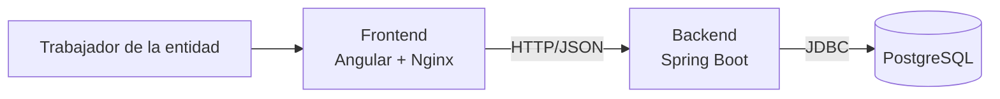
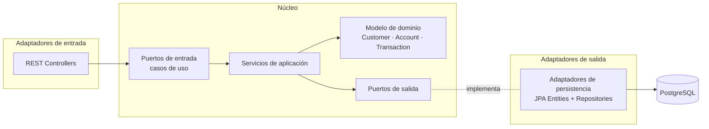
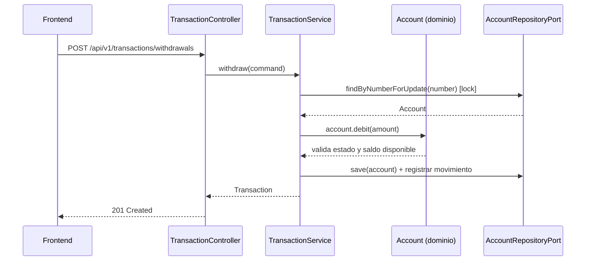

# 2. Arquitectura

## 2.1 Vista general



Cada bloque corre en su propio contenedor Docker (ver [Despliegue](06-despliegue.md)).

## 2.2 Arquitectura hexagonal (backend)

El backend sigue la **arquitectura hexagonal** (puertos y adaptadores):

- El **dominio** contiene las reglas de negocio y no depende de Spring, JPA ni HTTP.
- La **aplicación** orquesta los casos de uso.
- La **infraestructura** conecta el núcleo con el mundo exterior (REST y base de datos) a través de **puertos** (interfaces).



**Regla de dependencias:** las dependencias siempre apuntan hacia el dominio. La infraestructura conoce al dominio, pero el dominio no conoce a la infraestructura.

### Estructura de paquetes

Se incluyen explícitamente las capas exigidas (**entity, service, controller, repository**) dentro de la estructura hexagonal:

```
com.pruebatecnica.entidadfinanciera
├── domain
│   ├── model          # Customer, Account, Transaction, enums de dominio
│   ├── exception      # Excepciones de negocio
│   └── port
│       ├── in         # Casos de uso (interfaces)
│       └── out        # Puertos de persistencia (interfaces)
├── application
│   └── service        # ← capa SERVICE: implementación de los casos de uso
└── infrastructure
    ├── adapter
    │   ├── in/rest
    │   │   ├── controller   # ← capa CONTROLLER
    │   │   ├── dto          # Request / Response
    │   │   └── mapper       # DTO ↔ dominio
    │   └── out/persistence
    │       ├── entity       # ← capa ENTITY (entidades JPA)
    │       ├── repository   # ← capa REPOSITORY (Spring Data JPA)
    │       ├── mapper       # Entity ↔ dominio
    │       └── adapter      # Implementación de los puertos de salida
    └── config               # Configuración y manejo global de errores
```

### Flujo de una petición (ejemplo: retiro)



## 2.3 Patrones de diseño

| Patrón | Dónde se aplica | Para qué |
|---|---|---|
| **Ports & Adapters** | `domain.port` + `infrastructure.adapter` | Aislar el dominio de la tecnología. |
| **Repository** | Puertos de salida y repositorios Spring Data | Abstraer el acceso a datos. |
| **Adapter** | Adaptadores de persistencia | Traducir entre los puertos del dominio y JPA. |
| **Strategy** | Reglas por tipo de cuenta: `AccountTypePolicy` con `SavingsAccountPolicy` y `CheckingAccountPolicy` | Cada tipo define su prefijo, saldo mínimo y saldo disponible sin `if/else` repartidos por el código. |
| **Factory** | `AccountFactory`: creación de cuentas y generación del número de cuenta | Centralizar la construcción válida de una cuenta según su tipo. |
| **DTO + Mapper** | Capa REST (MapStruct) | No exponer el dominio ni las entidades JPA en la API. |
| **Builder** | Construcción de objetos de dominio y respuestas | Objetos legibles e inmutables. |
| **Dependency Injection** | Spring IoC | Bajo acoplamiento y facilidad de pruebas. |

## 2.4 Principios SOLID

| Principio | Aplicación |
|---|---|
| **S** — Responsabilidad única | Cada capa tiene una sola razón de cambio: el dominio guarda las reglas de negocio, el servicio orquesta los casos de uso de un agregado (`CustomerService`), el controller solo traduce HTTP y el adaptador de persistencia solo traduce a JPA. |
| **O** — Abierto/Cerrado | Un nuevo tipo de cuenta se agrega con una nueva estrategia, sin modificar los servicios existentes. |
| **L** — Sustitución de Liskov | Cualquier implementación de un puerto (JPA, en memoria para tests) es intercambiable. |
| **I** — Segregación de interfaces | Puertos pequeños y específicos (`CreateCustomerUseCase`, `DeleteCustomerUseCase`...) en lugar de una interfaz gigante. |
| **D** — Inversión de dependencias | Los servicios dependen de **interfaces** (puertos), no de implementaciones concretas de persistencia. |

## 2.5 Transacciones ACID

Las operaciones que modifican saldos se ejecutan en una única transacción de base de datos (`@Transactional`):

| Propiedad | Cómo se garantiza |
|---|---|
| **Atomicidad** | En una transferencia, el débito, el crédito, el GMF y el registro de movimientos ocurren todos o ninguno. Ante cualquier excepción se hace *rollback*. |
| **Consistencia** | Las reglas se validan en el dominio y se refuerzan en la BD con `CHECK`, `UNIQUE`, `FOREIGN KEY` y `NOT NULL`. |
| **Aislamiento** | Las cuentas involucradas se bloquean con `SELECT ... FOR UPDATE` (bloqueo pesimista). En las transferencias se bloquean **en orden ascendente de id** para evitar *deadlocks*. |
| **Durabilidad** | PostgreSQL persiste la transacción confirmada en su WAL (*write-ahead log*). |

Más detalle en [ADR-0004](adr/0004-concurrencia-y-saldos.md).

## 2.6 Manejo de errores

Un `@RestControllerAdvice` global traduce las excepciones a respuestas **RFC 7807 (Problem Details)**:

| Situación | HTTP |
|---|---|
| Datos de entrada inválidos (formato, campos obligatorios) | `400 Bad Request` |
| Recurso no encontrado | `404 Not Found` |
| Conflicto de unicidad o cliente con productos | `409 Conflict` |
| Regla de negocio violada (menor de edad, saldo insuficiente, cuenta inactiva...) | `422 Unprocessable Entity` |

## 2.7 Frontend

SPA en Angular organizada por funcionalidades, con componentes reutilizables:

```
src/app
├── core          # Layout, configuración HTTP, interceptor de errores, notificaciones
├── shared        # Componentes reutilizables (tablas, formularios, diálogos)
└── features
    ├── home
    ├── customers
    ├── accounts
    └── transactions
```

- **Angular 22 + Angular Material 22**, componentes *standalone* y *signals*.
- La URL de la API es relativa (`/api/v1`): en desarrollo la redirige `proxy.conf.json` y en Docker, Nginx. El navegador siempre habla con un solo origen y no se necesita CORS.
- Un **interceptor HTTP** muestra en un aviso el mensaje en español que devuelve la API (RFC 7807), así cada pantalla solo maneja el caso exitoso.
- Formato regional `es-CO`: moneda `$ 1.799.200,00` y fechas `dd/MM/yyyy`.
- Tests unitarios con **Vitest** (el *runner* por defecto de Angular 22).
