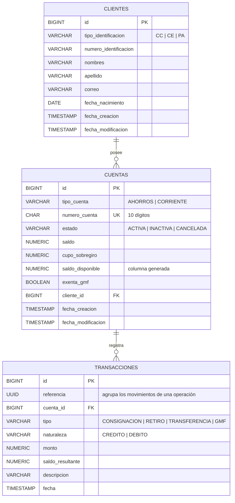

# 3. Modelo de datos

## 3.1 Diagrama entidad-relación

## 3.2 Decisiones de diseño

| Decisión | Motivo |
|---|---|
| Montos en `NUMERIC(19,2)` | Precisión exacta. Los tipos de punto flotante generan errores de redondeo con dinero. |
| `saldo_disponible` como **columna generada** (`GENERATED ALWAYS AS (saldo + cupo_sobregiro) STORED`) | Se persiste y se actualiza automáticamente con cada cambio de saldo, sin riesgo de inconsistencia. |
| **Secuencias independientes** por tipo de cuenta | Garantizan números únicos y concurrentes: `53` + secuencia de 8 dígitos para ahorros y `33` + secuencia de 8 dígitos para corriente. |
| `FOREIGN KEY ... ON DELETE RESTRICT` en `cuentas.cliente_id` | La BD también impide eliminar un cliente con productos (RF-04). |
| `CHECK` de mayoría de edad en `clientes` | Un menor no puede existir en la BD (RF-05). Como la edad solo aumenta con el tiempo, un registro válido nunca deja de serlo. |
| `referencia` (UUID) en transacciones | Agrupa los movimientos de una misma operación (débito + crédito + GMF de una transferencia). |
| `saldo_resultante` en cada movimiento | Permite reconstruir el estado de cuenta con el saldo después de cada movimiento. |

## 3.3 Restricciones de integridad

| Tabla | Restricción | Regla que protege |
|---|---|---|
| `clientes` | `UNIQUE (tipo_identificacion, numero_identificacion)` | SUP-07 |
| `clientes` | `CHECK (fecha_nacimiento <= CURRENT_DATE - INTERVAL '18 years')` | RF-05 |
| `clientes` | `CHECK (char_length(nombres) >= 2 AND char_length(apellido) >= 2)` | RF-08 |
| `cuentas` | `UNIQUE (numero_cuenta)` y `CHECK (numero_cuenta ~ '^(53|33)[0-9]{8}$')` | RF-12 |
| `cuentas` | `CHECK (tipo_cuenta = 'AHORROS' AND numero_cuenta LIKE '53%' OR tipo_cuenta = 'CORRIENTE' AND numero_cuenta LIKE '33%')` | RF-12 |
| `cuentas` | `CHECK (saldo >= -cupo_sobregiro)` | RF-14, SUP-01 |
| `cuentas` | `CHECK (tipo_cuenta = 'CORRIENTE' OR cupo_sobregiro = 0)` | Ahorros sin sobregiro |
| `cuentas` | `CHECK (estado <> 'CANCELADA' OR saldo = 0)` | RF-16 |
| `transacciones` | `CHECK (monto > 0)` | SUP-06 |

## 3.4 DDL y DML

Los scripts SQL se versionan con **Flyway** en `backend/src/main/resources/db/migration`:

| Script | Tipo | Contenido |
|---|---|---|
| `V1__crear_tablas.sql` | **DDL** | `CREATE TABLE`, `CREATE SEQUENCE`, restricciones e índices. |
| `V2__datos_iniciales.sql` | **DML** | `INSERT` de clientes, cuentas y movimientos de ejemplo para pruebas. |

Flyway ejecuta los scripts pendientes al arrancar la aplicación y registra cuáles ya se aplicaron en la tabla `flyway_schema_history`. Ver [ADR-0002](adr/0002-postgresql-y-flyway.md).
