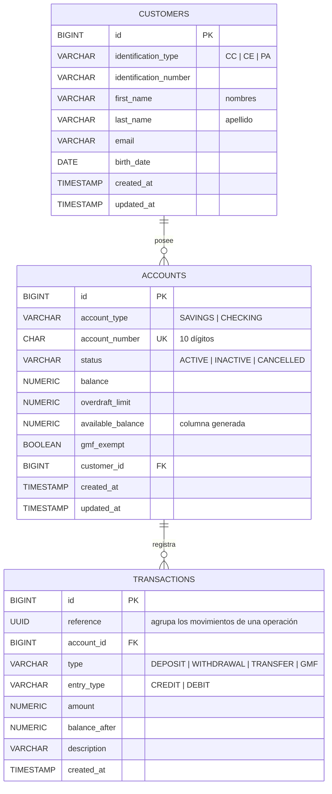

# 3. Modelo de datos

## 3.1 Diagrama entidad-relación

### Glosario

Los identificadores del código y de la base de datos están en inglés (ver [ADR-0005](adr/0005-idioma-del-codigo.md)). Equivalencias con los términos del negocio:

| Negocio | Código / BD |
|---|---|
| Cliente | `Customer` / `customers` |
| Cuenta (producto) | `Account` / `accounts` |
| Transacción / movimiento | `Transaction` / `transactions` |
| Cuenta de ahorros / corriente | `SAVINGS` / `CHECKING` |
| Activa / inactiva / cancelada | `ACTIVE` / `INACTIVE` / `CANCELLED` |
| Consignación / retiro / transferencia | `DEPOSIT` / `WITHDRAWAL` / `TRANSFER` |
| Crédito / débito | `CREDIT` / `DEBIT` |
| Saldo / saldo disponible | `balance` / `available_balance` |
| Cupo de sobregiro | `overdraft_limit` |
| Exenta GMF | `gmf_exempt` |

## 3.2 Decisiones de diseño

| Decisión | Motivo |
|---|---|
| Montos en `NUMERIC(19,2)` | Precisión exacta. Los tipos de punto flotante generan errores de redondeo con dinero. |
| `available_balance` como **columna generada** (`GENERATED ALWAYS AS (balance + overdraft_limit) STORED`) | Se persiste y se actualiza automáticamente con cada cambio de saldo, sin riesgo de inconsistencia. |
| **Secuencias independientes** por tipo de cuenta | Garantizan números únicos y concurrentes: `53` + secuencia de 8 dígitos para ahorros y `33` + secuencia de 8 dígitos para corriente. |
| `FOREIGN KEY ... ON DELETE RESTRICT` en `accounts.customer_id` | La BD también impide eliminar un cliente con productos (RF-04). |
| `CHECK` de mayoría de edad en `customers` | Un menor no puede existir en la BD (RF-05). Como la edad solo aumenta con el tiempo, un registro válido nunca deja de serlo. |
| `reference` (UUID) en transacciones | Agrupa los movimientos de una misma operación (débito + crédito + GMF de una transferencia). |
| `balance_after` en cada movimiento | Permite reconstruir el estado de cuenta con el saldo después de cada movimiento. |

## 3.3 Restricciones de integridad

| Tabla | Restricción | Regla que protege |
|---|---|---|
| `customers` | `UNIQUE (identification_type, identification_number)` | SUP-07 |
| `customers` | `CHECK (birth_date <= CURRENT_DATE - INTERVAL '18 years')` | RF-05 |
| `customers` | `CHECK (char_length(first_name) >= 2 AND char_length(last_name) >= 2)` | RF-08 |
| `accounts` | `UNIQUE (account_number)` y `CHECK (account_number ~ '^(53|33)[0-9]{8}$')` | RF-12 |
| `accounts` | `CHECK (account_type = 'SAVINGS' AND account_number LIKE '53%' OR account_type = 'CHECKING' AND account_number LIKE '33%')` | RF-12 |
| `accounts` | `CHECK (balance >= -overdraft_limit)` | RF-14, SUP-01 |
| `accounts` | `CHECK (account_type = 'CHECKING' OR overdraft_limit = 0)` | Ahorros sin sobregiro |
| `accounts` | `CHECK (status <> 'CANCELLED' OR balance = 0)` | RF-16 |
| `accounts` | `CHECK (status <> 'CANCELLED' OR overdraft_limit = 0)` | SUP-14 |
| `transactions` | `CHECK (amount > 0)` | SUP-06 |

## 3.4 DDL y DML

Los scripts SQL se versionan con **Flyway** en `backend/src/main/resources/db/migration`:

| Script | Tipo | Contenido |
|---|---|---|
| `V1__create_schema.sql` | **DDL** | `CREATE TABLE`, `CREATE SEQUENCE`, restricciones e índices. |
| `V2__seed_data.sql` | **DML** | `INSERT` de clientes, cuentas y movimientos de ejemplo para pruebas. |
| `V3__close_overdraft_of_cancelled_accounts.sql` | **DML + DDL** | Pone en $0 el cupo de las cuentas ya canceladas y agrega la restricción `ck_accounts_cancelled_no_overdraft` (SUP-14). |

Flyway ejecuta los scripts pendientes al arrancar la aplicación y registra cuáles ya se aplicaron en la tabla `flyway_schema_history`. Ver [ADR-0002](adr/0002-postgresql-y-flyway.md).
