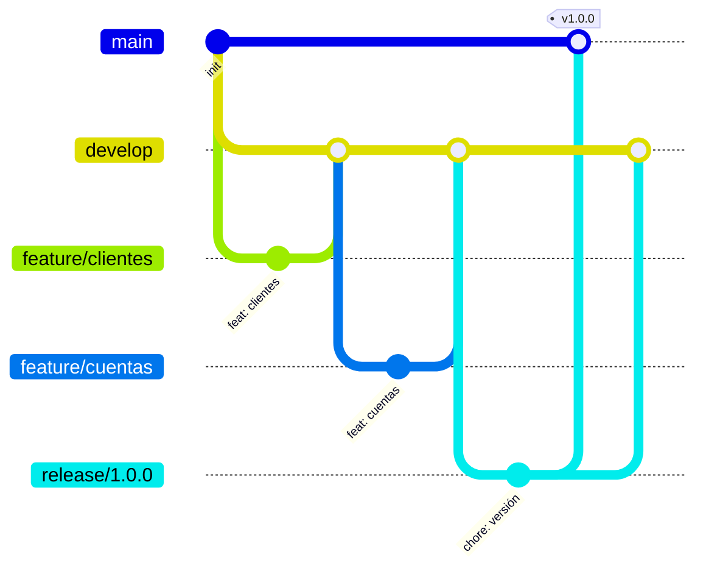

# 5. Git Flow y convenciones

## 5.1 Estrategia de ramas

El proyecto usa **Git Flow**:

| Rama | Propósito | Nace de | Se integra en |
|---|---|---|---|
| `main` | Código liberado (producción). Cada versión lleva un tag (`v1.0.0`). | — | — |
| `develop` | Integración de funcionalidades terminadas. | `main` | — |
| `feature/*` | Una funcionalidad (ej. `feature/clientes-crud`). | `develop` | `develop` |
| `release/*` | Estabilización de una versión (ej. `release/1.0.0`). | `develop` | `main` y `develop` |
| `hotfix/*` | Corrección urgente en producción. | `main` | `main` y `develop` |



### Equivalencia con ramas por ambiente

Muchos equipos usan ramas por ambiente (`dev` → `qa` → `main`). Git Flow tiene la misma progresión:

| Ambiente | Git Flow |
|---|---|
| Desarrollo | `develop` |
| QA / Pruebas | `release/*` |
| Producción | `main` |

## 5.2 Pull Requests

- Toda integración a `develop` o `main` se hace mediante **Pull Request**.
- El PR describe el cambio y referencia los requerimientos (RF/RNF) que atiende.
- El pipeline de **CI (GitHub Actions)** debe pasar (build y tests) antes de fusionar.
- La rama `feature/*` se elimina después de fusionarla.

## 5.3 Convención de commits

Se usa **[Conventional Commits](https://www.conventionalcommits.org/es/)**:

```
<tipo>(<alcance opcional>): <descripción en imperativo>
```

| Tipo | Uso |
|---|---|
| `feat` | Nueva funcionalidad |
| `fix` | Corrección de un error |
| `test` | Agregar o modificar pruebas |
| `docs` | Documentación |
| `refactor` | Cambio de código sin alterar el comportamiento |
| `chore` | Configuración, dependencias, tareas de mantenimiento |
| `ci` | Pipelines de integración continua |
| `build` | Docker, Maven, empaquetado |

**Ejemplos:**
```
feat(clientes): validar mayoría de edad al crear cliente
test(cuentas): cubrir cancelación con saldo distinto de cero
docs: documentar endpoints de transacciones
```

## 5.4 Versionamiento

Se usa **Versionamiento Semántico** (`MAJOR.MINOR.PATCH`). Cada release a `main` se etiqueta: `v1.0.0`, `v1.1.0`...
