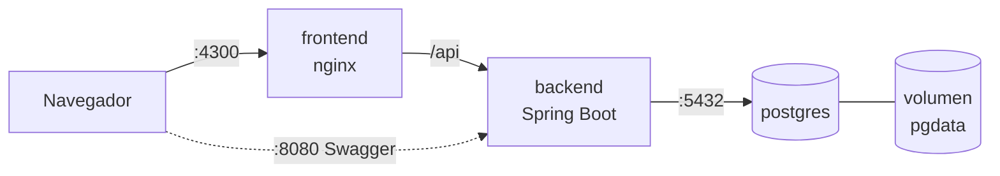

# 6. Despliegue

## 6.1 Contenedores

La solución corre en **3 contenedores** orquestados con Docker Compose:

| Contenedor | Imagen base | Puerto | Responsabilidad |
|---|---|---|---|
| `postgres` | `postgres:16-alpine` | 5432 | Base de datos, con volumen persistente. |
| `backend` | `eclipse-temurin:21-jre-alpine` | 8080 | API REST. Al arrancar aplica las migraciones Flyway. |
| `frontend` | `nginxinc/nginx-unprivileged:alpine` | 4300 → 8080 | Sirve la SPA compilada de Angular y redirige `/api` al backend. |



- Las imágenes del backend y del frontend usan **builds multi-stage**: una etapa compila (Maven / Node) y otra ejecuta, con lo que la imagen final queda liviana.

### Imagen del backend (`backend/Dockerfile`)

| Aspecto | Decisión |
|---|---|
| Compilación | `eclipse-temurin:21-jdk-alpine` con el Maven wrapper del proyecto. Primero se copian `pom.xml` y el wrapper y se descargan las dependencias, para que Docker las reutilice mientras solo cambie el código. La caché de `~/.m2` se monta con BuildKit. |
| Tests | Se omiten en la imagen (`-DskipTests`): los de integración necesitan Docker (Testcontainers) y se ejecutan en la integración continua. |
| Ejecución | `eclipse-temurin:21-jre-alpine`: solo el JRE, sin JDK ni Maven. |
| Capas | El JAR se separa con `-Djarmode=tools extract --layers` en dependencias, *loader*, dependencias *snapshot* y aplicación. Un cambio de código solo reconstruye la última capa. |
| Seguridad | Corre con el usuario sin privilegios `app`, no como `root`. |
| Memoria | `-XX:MaxRAMPercentage=75`: el *heap* se ajusta al límite de memoria del contenedor. |
| Salud | `HEALTHCHECK` contra `/actuator/health`: Docker marca el contenedor como *healthy* cuando la API responde `UP`. |
| Configuración | Variables de entorno `DB_HOST`, `DB_PORT`, `DB_NAME`, `DB_USERNAME`, `DB_PASSWORD` y `SERVER_PORT` (ver `application.yml`). |

### Imagen del frontend (`frontend/Dockerfile`)

| Aspecto | Decisión |
|---|---|
| Compilación | `node:24-alpine` (Angular 22 pide Node 22.22 o 24.15+). `npm ci` con `package-lock.json` y caché de npm de BuildKit; luego `npm run build`. |
| Ejecución | `nginxinc/nginx-unprivileged:alpine`: solo los archivos estáticos (≈ 93 MB), con Nginx corriendo sin `root` en el puerto 8080. |
| Un solo origen | Nginx redirige `/api/` al backend (`BACKEND_URL`, por defecto `http://backend:8080`), igual que `proxy.conf.json` en desarrollo. El navegador nunca habla con otro dominio, así que no se necesita CORS. |
| Rutas de Angular | `try_files ... /index.html`: abrir directamente `/customers/1` o recargar la página funciona. |
| Caché | Los JS y CSS llevan un *hash* en el nombre, así que se guardan un año (`immutable`). `index.html` va con `no-cache`, para tomar enseguida una versión nueva. |
| Compresión | `gzip` para JS, CSS, JSON y SVG. |
| Seguridad | Sin versión de Nginx en las respuestas y con las cabeceras `X-Content-Type-Options`, `X-Frame-Options` y `Referrer-Policy` en todas las rutas (`nginx/security-headers.conf`). |
| Salud | `HEALTHCHECK` contra `http://127.0.0.1:8080/` (no `localhost`, que dentro del contenedor resuelve primero a IPv6). |
- El backend espera a que PostgreSQL esté saludable (`healthcheck` + `depends_on`).
- La configuración sensible (credenciales de BD) se inyecta con variables de entorno (archivo `.env`, que no se versiona).

### Levantar el proyecto

```bash
cp .env.example .env
docker compose up --build
```

### Orquestación (`docker-compose.yml`)

| Servicio | Contenedor | Puerto en el equipo | Espera a |
|---|---|---|---|
| `postgres` | `entidad-financiera-db` | `DB_PORT` (5432) | — |
| `backend` | `entidad-financiera-api` | `BACKEND_PORT` (8080) | `postgres` *healthy* (`pg_isready`) |
| `frontend` | `entidad-financiera-web` | `FRONTEND_PORT` (4300) | `backend` *healthy* (`/actuator/health`) |

- **Arranque en orden:** `depends_on` con `condition: service_healthy`. La API no intenta conectarse antes de que PostgreSQL acepte conexiones, y Nginx no recibe tráfico antes de que la API responda.
- **Red interna:** los contenedores se encuentran por nombre de servicio. El backend usa siempre `postgres:5432` y Nginx `http://backend:8080`, sin importar los puertos publicados en el equipo.
- **Configuración:** credenciales y puertos en `.env` (plantilla `.env.example`, sin versionar el `.env`). Cada variable tiene un valor por defecto, así que `docker compose up --build` funciona sin `.env`.
- **Datos persistentes:** volumen `pgdata`. `docker compose down` conserva los datos; `docker compose down -v` los borra.
- **Reinicio:** `restart: unless-stopped` en los tres servicios.

## 6.2 Integración continua

Pipelines de **GitHub Actions** en cada push y Pull Request a `develop` y `main`. Cada uno se ejecuta solo cuando cambia su parte del repositorio (filtro `paths`), y un push nuevo cancela la ejecución anterior de la misma rama (`concurrency`).

### Backend (`.github/workflows/backend.yml`)

| Trabajo | Qué hace |
|---|---|
| **Compilar y probar** | Java 21 (Temurin) con caché de Maven y `./mvnw verify`: tests unitarios, tests de integración contra PostgreSQL real (Testcontainers usa el Docker del servidor de GitHub), reporte JaCoCo y sus mínimos de cobertura. Publica la tabla de cobertura en el resumen de la ejecución y guarda el reporte HTML como artefacto (`backend-coverage`, 14 días). Si algo falla, guarda también los reportes de Surefire (7 días). |
| **Construir imagen Docker** | Solo si los tests pasan. Construye `backend/Dockerfile` con Buildx y caché de GitHub Actions, sin publicarla. Comprueba que el Dockerfile sigue funcionando. |

Permisos mínimos: `contents: read`.

### Cobertura mínima

Los dos pipelines **fallan si la cobertura baja** de estos mínimos:

| Proyecto | Regla | Valor actual |
|---|---|---|
| Backend (JaCoCo, `pom.xml`) | Clases de `application.service` y `adapter.in.rest.controller`: **100 %** de líneas y ramas | 100 % |
| Backend | Todo el proyecto: ≥ 95 % de líneas y ≥ 90 % de ramas | 100 % / 100 % |
| Frontend (Vitest, `angular.json`) | ≥ 95 % de sentencias y líneas, ≥ 90 % de ramas y funciones | 98,5 % · 98,8 % · 94,4 % · 96,3 % |

Se excluye del cálculo el código que no se escribe a mano: las implementaciones generadas por MapStruct (`*MapperImpl`), la clase `main` del backend y los datos de prueba del frontend (`testing/`). Un script común (`.github/scripts/coverage_summary.py`) convierte los reportes en la tabla del resumen de cada ejecución.

### Frontend (`.github/workflows/frontend.yml`)

| Trabajo | Qué hace |
|---|---|
| **Probar y compilar** | Node 24 con caché de npm, `npm ci`, tests unitarios con cobertura (`npm run test:coverage`, Vitest + V8) y compilación de producción (`npm run build`), que falla si el paquete inicial supera el presupuesto de error de `angular.json`. Publica la tabla de cobertura en el resumen de la ejecución y guarda el reporte HTML (`frontend-coverage`, 14 días). |
| **Construir imagen Docker** | Solo si lo anterior pasa. Construye `frontend/Dockerfile` (Node + Nginx) con Buildx y caché de GitHub Actions, sin publicarla. |

Permisos mínimos: `contents: read`.

## 6.3 Servicios en la nube

La aplicación se publica en **Microsoft Azure**: una máquina virtual Linux (`Standard_B1ms`, región `westus2`) que ejecuta el mismo Docker Compose. Los motivos, las alternativas y las consecuencias están en el [ADR-0006](adr/0006-despliegue-en-azure.md).

> El procedimiento de despliegue, la URL pública y cómo apagar o borrar los recursos se documentan en el PR 9.2.
