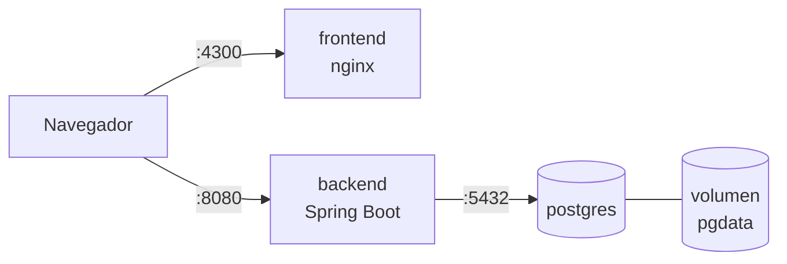

# 6. Despliegue

## 6.1 Contenedores

La solución corre en **3 contenedores** orquestados con Docker Compose:

| Contenedor | Imagen base | Puerto | Responsabilidad |
|---|---|---|---|
| `postgres` | `postgres:16-alpine` | 5432 | Base de datos, con volumen persistente. |
| `backend` | `eclipse-temurin:21-jre-alpine` | 8080 | API REST. Al arrancar aplica las migraciones Flyway. |
| `frontend` | `nginx:alpine` | 4300 → 80 | Sirve la SPA compilada de Angular. |



- Las imágenes del backend y del frontend usan **builds multi-stage**: una etapa compila (Maven / Node) y otra ejecuta, con lo que la imagen final queda liviana.
- El backend espera a que PostgreSQL esté saludable (`healthcheck` + `depends_on`).
- La configuración sensible (credenciales de BD) se inyecta con variables de entorno (archivo `.env`, que no se versiona).

### Levantar el proyecto

```bash
cp .env.example .env
docker compose up --build
```

## 6.2 Integración continua

Pipeline de **GitHub Actions** en cada push y Pull Request a `develop` y `main`:

1. Compilar el backend y ejecutar los tests (JUnit + JaCoCo).
2. Compilar el frontend y ejecutar sus tests.
3. Construir las imágenes Docker.

## 6.3 Servicios en la nube

> Se documenta al completar la fase de despliegue.
