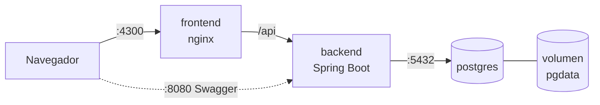

# 6. Despliegue

## 6.1 Contenedores

La solución corre en **3 contenedores** orquestados con Docker Compose:

| Contenedor | Imagen base | Puerto | Responsabilidad |
|---|---|---|---|
| `postgres` | `postgres:16-alpine` | 5432 | Base de datos, con volumen persistente. |
| `backend` | `eclipse-temurin:21-jre-alpine` | 8080 | API REST. Al arrancar aplica las migraciones Flyway. |
| `frontend` | `nginxinc/nginx-unprivileged:alpine` | 4300 → 8080 | Sirve la SPA compilada de Angular y redirige `/api` al backend. |



- Las imágenes del backend y del frontend usan **builds multi-stage**: una etapa compila (Maven / Node) y otra ejecuta, con lo que la imagen final queda liviana.

### Imagen del backend (`backend/Dockerfile`)

| Aspecto | Decisión |
|---|---|
| Compilación | `eclipse-temurin:21-jdk-alpine` con el Maven wrapper del proyecto. Primero se copian `pom.xml` y el wrapper y se descargan las dependencias, para que Docker las reutilice mientras solo cambie el código. La caché de `~/.m2` se monta con BuildKit. |
| Tests | Se omiten en la imagen (`-DskipTests`): los de integración necesitan Docker (Testcontainers) y se ejecutan en la integración continua. |
| Ejecución | `eclipse-temurin:21-jre-alpine`: solo el JRE, sin JDK ni Maven. |
| Capas | El JAR se separa con `-Djarmode=tools extract --layers` en dependencias, *loader*, dependencias *snapshot* y aplicación. Un cambio de código solo reconstruye la última capa. |
| Seguridad | Corre con el usuario sin privilegios `app`, no como `root`. |
| Memoria | `-XX:MaxRAMPercentage=75`: el *heap* se ajusta al límite de memoria del contenedor. |
| Salud | `HEALTHCHECK` contra `/actuator/health`: Docker marca el contenedor como *healthy* cuando la API responde `UP`. |
| Configuración | Variables de entorno `DB_HOST`, `DB_PORT`, `DB_NAME`, `DB_USERNAME`, `DB_PASSWORD` y `SERVER_PORT` (ver `application.yml`). |

### Imagen del frontend (`frontend/Dockerfile`)

| Aspecto | Decisión |
|---|---|
| Compilación | `node:24-alpine` (Angular 22 pide Node 22.22 o 24.15+). `npm ci` con `package-lock.json` y caché de npm de BuildKit; luego `npm run build`. |
| Ejecución | `nginxinc/nginx-unprivileged:alpine`: solo los archivos estáticos (≈ 93 MB), con Nginx corriendo sin `root` en el puerto 8080. |
| Un solo origen | Nginx redirige `/api/` al backend (`BACKEND_URL`, por defecto `http://backend:8080`), igual que `proxy.conf.json` en desarrollo. El navegador nunca habla con otro dominio, así que no se necesita CORS. |
| Rutas de Angular | `try_files ... /index.html`: abrir directamente `/customers/1` o recargar la página funciona. |
| Caché | Los JS y CSS llevan un *hash* en el nombre, así que se guardan un año (`immutable`). `index.html` va con `no-cache`, para tomar enseguida una versión nueva. |
| Compresión | `gzip` para JS, CSS, JSON y SVG. |
| Seguridad | Sin versión de Nginx en las respuestas y con las cabeceras `X-Content-Type-Options`, `X-Frame-Options` y `Referrer-Policy` en todas las rutas (`nginx/security-headers.conf`). |
| Salud | `HEALTHCHECK` contra `http://127.0.0.1:8080/` (no `localhost`, que dentro del contenedor resuelve primero a IPv6). |
- El backend espera a que PostgreSQL esté saludable (`healthcheck` + `depends_on`).
- La configuración sensible (credenciales de BD) se inyecta con variables de entorno (archivo `.env`, que no se versiona).

### Levantar el proyecto

```bash
cp .env.example .env
docker compose up --build
```

## 6.2 Integración continua

Pipeline de **GitHub Actions** en cada push y Pull Request a `develop` y `main`:

1. Compilar el backend y ejecutar los tests (JUnit + JaCoCo).
2. Compilar el frontend y ejecutar sus tests.
3. Construir las imágenes Docker.

## 6.3 Servicios en la nube

> Se documenta al completar la fase de despliegue.
